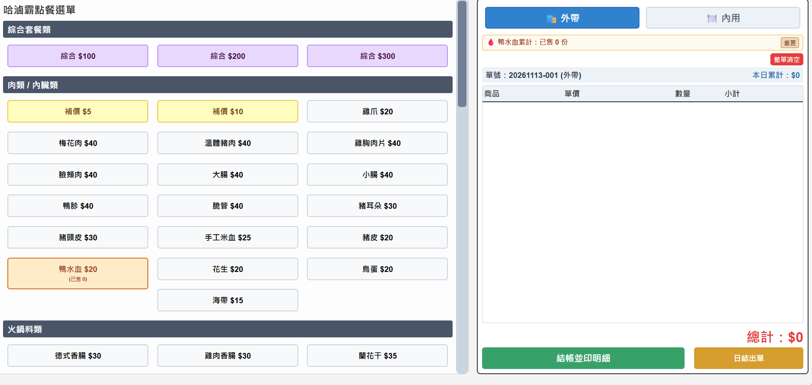
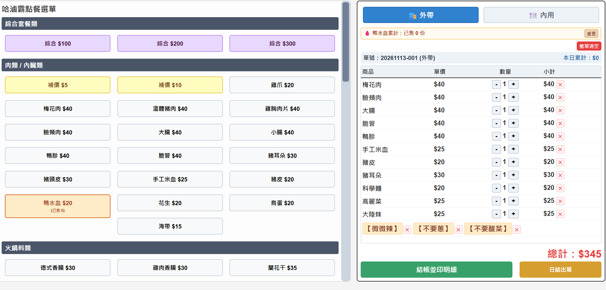
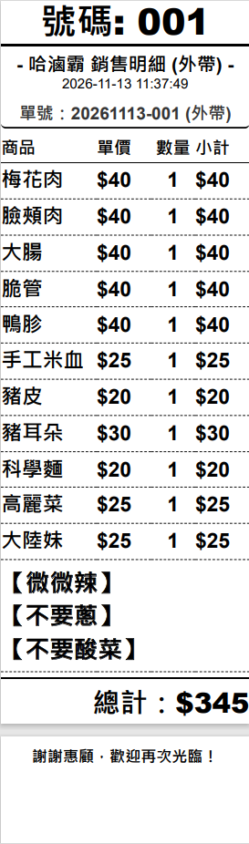
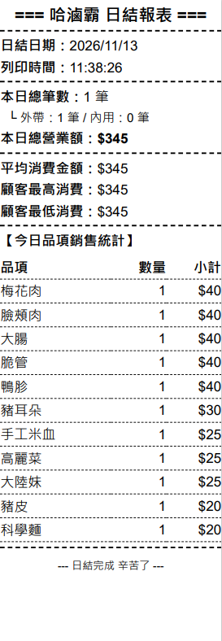

# 哈滷霸 POS 點餐系統

為家中經營的滷味小吃店開發的點餐與結帳系統，**已實際用於營業**。單一 HTML 檔、無需後端與網路，可在舊型觸控設備上執行，並搭配熱感應出單機列印明細。

> **English summary:** A lightweight point-of-sale web app built for my family's braised-food snack shop and used in daily operation. Single-file HTML/CSS/JavaScript, no backend, data kept in `localStorage`. Optimized for Windows XP + Chrome 49 touch screens and 80 mm thermal receipt printers.

## 畫面截圖

**點餐主畫面**（左：菜單，右：購物車與結帳）

**點餐中**（加入品項與口味客制，即時計算總計）

| 結帳明細（熱感應單據） | 日結報表 |
| --- | --- |
|  |  |

> 截圖中的訂單與營收皆為測試資料。

## 功能

- **點餐選單**：依類別分區（綜合套餐、肉類／內臟、火鍋料、豆類、蔬菜、麵類、其他），大按鈕一鍵加入購物車
- **口味客制**：辣度與備註選項（例如微辣、中辣、不要蔥、湯多）以 $0 品項加入單中，並隨明細列印
- **自訂品項**：可輸入品名與金額臨時新增
- **購物車**：數量加減、刪除單項、整單清空，即時計算總計
- **外帶／內用切換**：結帳後自動切回外帶，減少漏切
- **每日單號**：以「日期＋當日流水號」編號（例如 20261113-001），流水號每天從 001 開始，跨日自動重置；明細上方以大字顯示號碼，方便叫號
- **結帳列印**：一鍵結帳並列印大字單聯明細（單號、外帶／內用、時間、品項），有防止重複結帳的保護
- **日結報表**：本日總筆數（外帶／內用）、總營業額、平均／最高／最低消費、各品項銷售數量與小計
- **熱門品項用量追蹤**：即時顯示鴨水血已售份數，可手動重置

## 技術

- HTML、CSS、JavaScript（原生，無框架、無建置步驟）
- 資料存放於瀏覽器 `localStorage`，無法使用時自動退回記憶體暫存
- 列印使用 `window.print()` 搭配 `@media print` 樣式，版面為 **80 mm 熱感應紙**

## 設計考量

店內使用的是舊型觸控設備（Windows XP、Chrome 49），因此刻意做了以下取捨：

- 只使用舊瀏覽器支援的語法與排版（以 `float` 取代較新的版面配置，避免新式 JavaScript 語法）
- 大字體、加粗的滾動條、停用文字選取，方便在觸控螢幕上操作
- 不依賴後端與網路，斷網時照常營業

## 使用方式

1. 下載專案，直接用瀏覽器開啟 `index.html`
2. 點選品項加入購物車，選擇外帶或內用
3. 按「結帳並印明細」列印，營業結束後按「日結出單」

**硬體環境：** 觸控螢幕電腦＋熱感應出單機（USB 連接，80 mm 紙寬）

## 已知限制

- 資料存在單一瀏覽器的 `localStorage`，**清除瀏覽器資料會遺失當日統計**，且不同裝置之間不會同步
- 菜單與價格直接寫在 HTML 內，修改需要編輯原始檔
- 日結資料只保留當天，跨日後會重置

## 可改進方向

- 將菜單抽成設定檔，方便調整品項與價格
- 日結資料匯出成 CSV，保留歷史紀錄
- 資料備份機制

## 備註

本專案為個人專案，為實際營業需求而開發。
